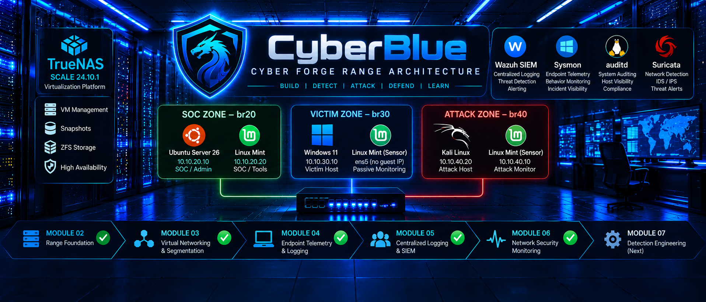

# CyberBlue — Cybersecurity Home Lab & Portfolio



## Overview

**CyberBlue** is my hands-on cybersecurity engineering lab and technical portfolio, built using TrueNAS SCALE, KVM/QEMU virtualization, Linux, Windows, and open-source security tools.

The purpose of this project is to demonstrate practical skills in infrastructure engineering, network segmentation, endpoint monitoring, security validation, troubleshooting, and technical documentation.

My approach is to build each capability, understand how it works, validate its behavior, deliberately test failure scenarios where appropriate, and document the results with supporting evidence.

This repository records actual lab work, including successful tests, troubleshooting findings, configuration limitations, and recovery procedures.

---

## Lab Environment

| Component | Role |
|---|---|
| TrueNAS SCALE 24.10.1 | Virtualization and storage host |
| Intel Core i5-3330 / 32 GB RAM | Physical lab hardware |
| KVM/QEMU | Virtualization technology |
| Ubuntu Server 26.04.1 LTS | Linux endpoint and CyberBlue management server |
| Ubuntu Server 24.04.5 LTS (`SIEM_01`) | Dedicated Wazuh 4.14.8 SIEM server — manager, indexer, dashboard, and Filebeat |
| Kali Linux 2026.2 | Controlled security testing |
| Linux Mint 22.3 | Linux lab endpoint |
| Windows 11 | Windows endpoint and security event testing |
| Sysmon | Enhanced Windows endpoint telemetry |
| auditd | Enhanced Linux security auditing |
| GitHub | Technical documentation and evidence portfolio |

## Network Architecture

**Current verified guest-network state (2026-10-18, Module 06):** CyberBlue uses a home/management LAN and three TrueNAS-managed virtual lab bridges. The new zone layout is **partially implemented**, not yet a fully validated isolation boundary.

```text
               HOME / MANAGEMENT LAN
                   192.168.1.0/24
                          |
                  TrueNAS SCALE
                    KVM / QEMU
                          |
         +----------------+----------------+
         |                |                |
       br20             br30             br40
      SOC ZONE        VICTIM ZONE        ATTACK ZONE
   10.10.20.0/24     10.10.30.0/24     10.10.40.0/24
         |                |                |
   Ubuntu .20.10    Windows .30.10    Kali .40.20
   Mint   .20.11                      Mint .40.10
                                  (Suricata capture)
```

Ubuntu's former `br30` VirtIO NIC remains present without an IPv4 address (it appeared as `ens3` after guest reboot); Mint also has a passive capture NIC on `br30`. Windows Victim uses `10.10.30.10/24` after Ubuntu released it. Kali Attack uses `10.10.40.20/24` on `br40` after its validated migration and recovery. Separate management NICs remain in use; the dedicated Wazuh SIEM is still on the management LAN.

On **2026-10-19**, controlled Kali Attack ↔ Windows Victim **IPv4 ICMP forwarding** tests showed four unanswered probes in each direction and a matching **+4 packet increase** in each TrueNAS bridge-to-bridge DROP counter. This validates the tested `br40` ↔ `br30` paths, **not** other protocols, SOC `br20` isolation, IPv6, alternate management-LAN paths, or TrueNAS host reboot persistence.

### Approved Target Zones — Migration In Progress

The intended **guest placement** is now validated: `br20` for SOC (Ubuntu and Mint), `br30` for Windows Victim, and `br40` for Kali Attack, with Mint sensor connections and management access preserved in the recorded layout. **Default-deny inter-zone communication with narrowly authorized exceptions is the approved security design as of 2026-10-19; it is not yet fully implemented or validated.** [See the approved policy](docs/architecture.md#14-approved-default-deny-inter-zone-policy--design-decision-2026-10-19). TrueNAS host reboot persistence and comprehensive passive monitoring also remain open.

See the [approved target design and staged-migration safeguards](docs/architecture.md#13-approved-target-architecture--soc--victim--attack-segmentation-2026-10-16) and [Module 06 results](modules/module-06-network-security-monitoring/README.md#module-06--staged-network-migration-2026-10-18).

---

## CyberBlue Project Index

| Project | Focus | Status |
|---|---|---|
| [Module 02 — Range Foundation](modules/module-02-range-foundation/README.md) | TrueNAS VM provisioning, networking, lifecycle, and recovery | **Validated** |
| [Module 03 — Virtual Networking & Segmentation](modules/module-03-virtual-networking-segmentation/README.md) | Persistent bridges, addressing, routing controls, and troubleshooting | **Validated** |
| [Module 04 — Endpoint Telemetry & Logging](modules/module-04-endpoint-telemetry-logging/README.md) | Windows Event Logs, Sysmon, Linux auditd, visibility gaps, and recovery | **Validated — historical evidence limitation documented** |
| [Module 05 — Centralized Logging & SIEM Foundations](modules/module-05-centralized-logging-siem/README.md) | Wazuh 4.14.8, Windows Sysmon alerting, Threat Hunting searches, and selected Windows 11 CIS hardening | **Complete — foundational SIEM deployment and Windows 11 telemetry validated** |
| [Module 06 — Network Security Monitoring (Suricata & Wazuh)](modules/module-06-network-security-monitoring/README.md) | Suricata/Wazuh validation and Module 06 SOC/Victim/Attack guest network migration | **Sensor validated; all three guest migrations validated; full zone isolation OPEN** |

Additional projects will be added only as implementation and validation progress.

---

## Module 02 — Range Foundation

Established the TrueNAS SCALE virtualization environment and validated Ubuntu Server VM deployment.

**Capabilities demonstrated:**
- VM resource provisioning
- Virtual storage and VirtIO networking
- Guest operating system installation
- Remote SSH administration
- VM shutdown and restart testing
- Snapshot recovery validation
- Infrastructure documentation

[View Module 02 →](modules/module-02-range-foundation/README.md)

---

## Module 03 — Virtual Networking & Segmentation

Implemented dedicated TrueNAS-managed Linux bridges to create separate CyberBlue lab networks.

**Capabilities demonstrated:**
- Linux bridge networking
- Persistent VM network interfaces
- Static IPv4 addressing
- Routing and gateway validation
- Firewall-controlled IPv4 forwarding
- Troubleshooting macvtap and libvirt network behavior
- Controlled failure and recovery testing
- Distinguishing network segmentation from complete host isolation

[View Module 03 →](modules/module-03-virtual-networking-segmentation/README.md)

---

## Module 04 — Endpoint Telemetry & Logging

Investigated native and enhanced security telemetry across Windows and Linux systems.

**Capabilities demonstrated:**
- Windows Security and System event analysis
- Windows process, service, authentication, and file auditing
- Sysmon process, network, and file telemetry
- Linux journald and authentication log investigation
- Linux auditd monitoring
- Controlled logging failures
- Visibility-gap analysis
- Telemetry restoration and recovery validation

**Evidence note:** Fourteen evidence entries are marked PASS, and one historical Sysmon timeline evidence item is marked Partial because the original event is no longer retained in the current event log.

[View Module 04 →](modules/module-04-endpoint-telemetry-logging/README.md)

---

## Module 05 — Centralized Logging & SIEM Foundations

**Status: Complete — Foundational SIEM Deployment**

Deployed Wazuh 4.14.8 on a dedicated Ubuntu Server VM and enrolled the Windows 11 endpoint. Validated centralized Sysmon alert generation, storage, and Threat Hunting dashboard searches. Performed Windows 11 CIS Security Configuration Assessment and documented selected hardening remediations through V-45.

Additional endpoint onboarding, complete raw-event ingestion coverage, and outstanding CIS findings remain future work.

[View Module 05 →](modules/module-05-centralized-logging-siem/README.md)

---

## Module 06 — Network Security Monitoring (Suricata & Wazuh)

**Status: Sensor Detection Validated; Module 06 Guest Network Migration Validated; six of six directed, routed IPv4 ICMP firewall tests PASS in controlled windows (persistent three-zone isolation still OPEN)**

Configured Suricata on Linux Mint to detect a controlled ICMP test, forward EVE JSON telemetry through the Wazuh agent, and generate a centralized Wazuh alert. A controlled Suricata process failure confirmed systemd automatic recovery; the sensor resumed detection and Wazuh continued receiving alerts. Point-in-time capture statistics reported zero kernel drops and zero capture errors.

Visibility into traffic exchanged between other VMs on TrueNAS bridge `br40` has not been demonstrated and remains a separate follow-up.

**Module 06 update (2026-10-18):** Ubuntu released `10.10.30.10` while retaining management `192.168.1.243` and SOC `10.10.20.10`. Windows moved from temporary `10.10.30.11` to Victim `10.10.30.10` on `br30`, retaining management `192.168.1.151`. Kali moved from `br30` / `10.10.30.20` to Attack `br40` / `10.10.40.20`, retaining management `192.168.1.91`. After an interface-order change interrupted Kali SSH, we recovered the VM using its SPICE console, set persistent NIC MAC addresses and MAC-bound NetworkManager profiles, and validated guest reboot persistence, SSH and both gateway connections. Six screenshots are recorded. **Inter-zone security controls, full IDS visibility and TrueNAS host bridge reboot persistence remain open.** See [Module 06 validation](modules/module-06-network-security-monitoring/validation.md#module-06--staged-network-migration-validation-2026-10-18).

**Module 06 controlled firewall trial (2026-10-19):** All six directed, routed IPv4 ICMP paths among SOC `br20`, Victim `br30`, and Attack `br40` were blocked in scoped tests with matching TrueNAS `iptables` DROP counters. The four SOC-direction checks used a temporary six-rule candidate protected by automatic rollback timers. After the tests, temporary routes were removed, baseline firewall rules were restored, and all rollback timers were verified inactive. **Only the original Victim ↔ Attack rules remain active; persistent SOC default-deny is not deployed.** IPv6, additional protocols, management-LAN bypasses, TrueNAS host persistence, and full Suricata mirroring remain open. [Detailed validation](modules/module-06-network-security-monitoring/validation.md#module-06--three-zone-scoped-ipv4-icmp-firewall-trial-2026-10-19).

[View Module 06 →](modules/module-06-network-security-monitoring/README.md)

---

## Technical Skills Demonstrated

**Infrastructure & Virtualization**
- TrueNAS SCALE administration
- KVM/QEMU virtual machines
- Virtual storage and resource management
- Linux and Windows guest administration

**Networking & Troubleshooting**
- IPv4 networking and routing
- Linux bridges and virtual NICs
- Network segmentation
- Firewall policy validation
- Connectivity testing and fault isolation

**Security Operations**
- Windows Event Viewer
- Windows Security auditing
- Sysmon
- Linux journald and auditd
- Security event investigation
- Telemetry coverage analysis
- Controlled failure and recovery testing

**Engineering Practices**
- Evidence-based validation
- Root cause investigation
- Technical documentation
- Reproducible testing
- GitHub portfolio management

---

## Engineering Workflow

```text
UNDERSTAND
    |
    v
DESIGN
    |
    v
BUILD
    |
    v
VALIDATE
    |
    v
TEST / TROUBLESHOOT
    |
    v
RECOVER
    |
    v
DOCUMENT
    |
    v
IMPROVE
```

The goal is not simply to install security products. It is to understand the underlying capabilities, validate them through repeatable testing, and document what the results actually demonstrate.

---

## Documentation and Evidence

Each CyberBlue project is intended to contain:

- `README.md` — objectives, architecture, implementation overview, and results
- `build-notes.md` — configuration details, commands, troubleshooting, and lessons learned
- `validation.md` — tests performed, observed results, and evidence references
- Screenshots or other supporting artifacts where available

Validation results and evidence limitations are documented rather than assumed.

---

## Portfolio Purpose

CyberBlue demonstrates practical infrastructure and security engineering skills through hands-on projects that can be reviewed independently.

The repository is intended to serve as a technical learning record, troubleshooting journal, cybersecurity portfolio, and foundation for future security operations and detection engineering projects.

**Repository maintained by:** [petew-tech](https://github.com/petew-tech)
